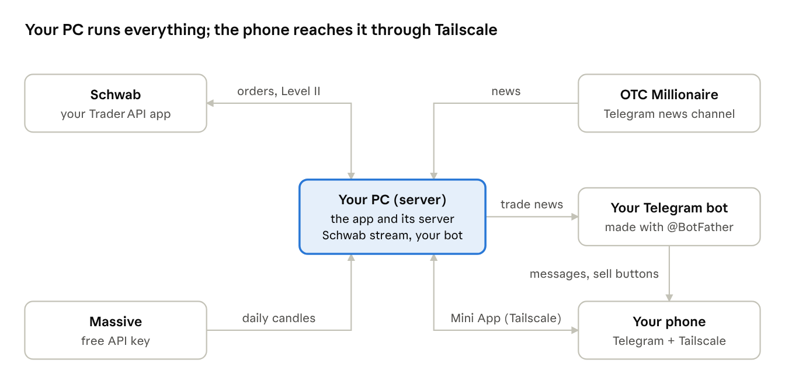

# OTC Assistant: Installation Guide

For someone setting up OTC Assistant with their **own** Schwab account, Telegram account and Tailscale network.

## At a glance



Your PC is the server: it talks to Schwab with your own API app, reads the news with your own Telegram account, and sends your bot's messages. Your phone gets the bot's messages through Telegram, and opens the Mini App on your PC through Tailscale.

## Before you start

Setting up OTC Assistant with your own Schwab and Telegram accounts takes about 1–2 hours of work, plus up to a few days of waiting for Schwab to approve your API app. Start with steps 1 and 2 today, so the approval runs while you do the rest.

Everything below is yours alone: your Schwab keys, your bot, your Tailscale network. Nothing is shared with the person who gave you this guide.

| You need | What it's for | Cost |
| --- | --- | --- |
| A Windows 10/11 PC that's on during market hours | Your **server**: it runs the app, the Schwab stream and your Telegram bot | — |
| A Schwab brokerage account | The trading account the app works with | — |
| A US mobile number that can receive SMS | Signing up at Schwab's developer site (step 1) | A few dollars at TextVerified (check their current prices) |
| A phone with Telegram | Your bot's notifications, sell buttons and the Mini App | Free |
| Access to the OTC Millionaire channel on Telegram | The news panel (step 8) | Whatever the channel's own terms are |
| A Tailscale account | Opening the Mini App on your phone from anywhere | Free personal plan |
| A Massive account | The daily candles for charts and scanners | Free plan |

Keep a text file with what you collect along the way: the Schwab App Key and Secret, the bot token, the Telegram api_id and api_hash, the Massive key. **Never share these, or post them anywhere.**

## Step 1: A US phone number (TextVerified)

Schwab's developer site asks for a US mobile number for its verification codes. If you don't have one, rent one at TextVerified.

1. Go to [app.textverified.com](https://app.textverified.com/) and create an account. Add a few dollars of credit.
2. Choose a **non-VoIP US number**. Sites like Schwab often refuse VoIP numbers.
3. Prefer a **rental** (monthly) over a one-time code. Schwab may text that number again later, for example when you log in to the developer site from a new browser.
4. Write the number down. Keep the TextVerified page open: the codes Schwab sends appear there.

If the rental runs out, you may lose the way to log in to your Schwab developer account. Renew it, or change the account's phone number to one you'll keep.

## Step 2: Your Schwab API app

The app talks to Schwab through an "app" you register on Schwab's developer site. It gives you an **App Key** and a **Secret**. This developer account is separate from your brokerage login.

1. Go to [developer.schwab.com](https://developer.schwab.com/) and click **Register**. Use your email and the US number from step 1 for the codes.
2. Confirm your email with the link Schwab sends (it expires after a while).
3. Choose the profile **Individual Developer**.
4. Under **API Products**, request access to the **Trader API – Individual** if the site asks for it.
5. Open the **Dashboard** and click **Create App**:
   - **API Product**: choose **Accounts and Trading Production**. Also add **Market Data Production** if it's offered.
   - **Order Limit**: 120.
   - **App Name** and **Description**: anything, e.g. "OTC Assistant".
   - **Callback URL**: exactly `https://127.0.0.1` (no port, no slash at the end). Step 4 must use the very same text.
6. Wait for approval. **"Approved – Pending" isn't ready yet.** Wait until the status says **Ready For Use**, which can take a few days.
7. Click your app in the dashboard and copy its **App Key** and **Secret** to your text file.

If creating the app fails with a callback URL error, try again later or email Schwab's Trader API team at traderapi@schwab.com.

## Step 3: Install the app on your server PC

Install Python and Git, download the app with Git, and start it once. With Git, the app can update itself later with its **Check for update** button.

1. **Python 3.11 or newer**: download it from [python.org/downloads](https://www.python.org/downloads/). In the installer, keep **py launcher** ticked, or tick **Add python.exe to PATH**.
2. **Git**: download it from [git-scm.com/download/win](https://git-scm.com/download/win) and install it with the default choices.
3. Open **Command Prompt** and run:

   ```
   git clone https://github.com/kobygold/OTC-assistant.git C:\github\OTC-assistant
   ```

4. In File Explorer, open `C:\github\OTC-assistant` and double-click **run_otc_gui.bat**. The first run installs the packages (about a minute) and puts an **OTC Assistant** shortcut on your desktop. Use that shortcut from now on.
5. If Windows asks whether Python may accept connections, click **Allow** on private networks.
6. Close the app. The first run created **settings.json** in the app's folder, which step 4 uses.

## Step 4: Your Schwab keys and the first login

The App Key and Secret are typed into `settings.json` by hand; the login itself is done from the app. Do this once your Schwab app says **Ready For Use**.

1. Close the app. Open `C:\github\OTC-assistant\settings.json` with Notepad. If the file isn't there, create it.
2. Add these three lines right after the first `{`, with your own key and secret (keep the quotes and the commas):

   ```
   "schwab_app_key": "YOUR APP KEY",
   "schwab_app_secret": "YOUR SECRET",
   "schwab_callback_url": "https://127.0.0.1",
   ```

   If the file was empty, its whole content is those lines between `{` and `}`, without the comma after the last one.

3. Save, and start the app from the desktop shortcut.
4. Click **Renew Schwab login...** at the top. A Schwab page opens in your browser:
   1. Log in with your regular Schwab **brokerage** login.
   2. Select your accounts and click **Allow**.
   3. The browser ends on a page that can't be reached (127.0.0.1). That's expected.
   4. Copy the **full** address from the address bar, paste it into the app and click **OK**. Do it within about 30 seconds: the code in the address expires.
5. Choose your account in **Account:** at the top. Level II starts streaming, and the **Monitor** tab shows your stocks and orders.

The login lasts 7 days. The **Renew Schwab login...** button changes color as the end gets near, and on weekends the app reminds you to renew it.

## Step 5: The daily candles (Massive)

The charts, Zones and the ATM Scanner use daily candles of every OTC stock, downloaded from Massive (formerly Polygon.io). A free key is enough.

1. Sign up at [massive.com](https://massive.com) and copy your **API key** from the dashboard.
2. In the app, open the **Download** tab and paste it into **Massive API key**.
3. Leave **API calls per minute** at 5 (the free plan's limit).
4. Tick **Download new days automatically** and click **Start**. The first download fetches about 2 years, one day per call, so it runs for a couple of hours. The app stays usable meanwhile.
5. Click **Update names from Massive** once, for the company names.

## Step 6: Tailscale on the PC and the phone

The Mini App (the app's screens inside Telegram on your phone) is served by your PC. Tailscale is a free private network that lets only your own devices reach it, from anywhere, with no router setup and nothing open to the internet.

1. Create a Tailscale account at [tailscale.com](https://tailscale.com) (you sign in with Google, Microsoft, GitHub or Apple).
2. **On the PC**: install Tailscale from [tailscale.com/download](https://tailscale.com/download) and sign in with that account.
3. In the admin console, open [login.tailscale.com/admin/dns](https://login.tailscale.com/admin/dns) and turn on **MagicDNS** and **HTTPS Certificates**.
4. On the PC, open **Command Prompt** and run:

   ```
   tailscale serve --bg 8790
   ```

   If it prints a link asking to enable Serve or HTTPS, open the link, approve, and run the command again. `tailscale serve status` shows the address, like `https://your-pc.your-tailnet.ts.net`. You only do this once; it stays on after restarts.

5. **On the phone**: install **Tailscale** from the App Store or Google Play, sign in with the **same** account, and switch it on.

The Mini App works while the app is open on the PC and Tailscale is on, on both. Your bot (step 7) points its **Open app** button to this address by itself.

## Step 7: Your own Telegram bot

Your bot sends your trades' news to your phone (bought, sold, canceled, login running out), can sell from the phone, and opens the Mini App. You create it with Telegram's @BotFather; only phones you link can use it.

1. In Telegram, open [@BotFather](https://t.me/BotFather) and send `/newbot`.
2. Give it a display name (e.g. "My OTC Assistant") and a username that ends in `bot` (e.g. `my_otc_assistant_bot`).
3. BotFather answers with a **token** like `123456789:AA...`. Copy it to your text file. Anyone with this token controls your bot.
4. In the app, open **Settings**, and in the **Telegram** section paste it into **Bot token**.
5. Click **Add phone...**. The app shows a code like `/link 482913`, valid for 10 minutes.
6. On your phone, open your new bot (search its username), tap **Start**, and send it the `/link` line. The bot answers that the phone is linked to your account.
7. Back in Settings, choose what the phone gets: the news only, or the news and the sell buttons. Selling from Telegram stays off until you tick **Allow selling from Telegram** for the account.
8. Press **Test** to get a test message on the phone.

After step 6 is done, the bot's menu button **Open app** opens the Mini App.

## Step 8: The OTC Millionaire news channel

The News panel shows the OTC Markets changes and headlines posted in the OTC Millionaire channel. A bot can't read a channel it doesn't run, so the app reads it with **your own** Telegram account, through Telegram's API keys.

1. **Join the channel** with your Telegram account. You need access to it (an invite or subscription, as the channel's owners give it). Once you're in, this link opens it: [web.telegram.org/a/#-1002497575051](https://web.telegram.org/a/#-1002497575051).
2. Go to [my.telegram.org](https://my.telegram.org), log in with your phone number (the code arrives in the Telegram app), and open **API development tools**.
3. Create an application: any **App title** and **Short name** (e.g. "otcnews"), platform **Desktop**. Copy its **api_id** (a number) and **api_hash** (32 letters and digits).
4. In the app, open **Settings**, section **News Telegram Bot**: paste the **api_id** and **api_hash**. Leave **Channel** as it is (`-1002497575051`).
5. Click **Log in...**, enter your phone number with its country code and click **Send code**. Type the code Telegram sends you, and your two-step verification password if you have one. If no code arrives, use **Log in with a QR code instead** and scan it with Telegram on your phone (Settings → Devices → Link Desktop Device).
6. Click **Test: read the last posts** to check that it works.
7. Optional: **Read back 6 months** fills the news history, so older news shows on your charts too.

The api_hash and the login stay in `settings.json` on your PC. Treat them like a password: they give access to your Telegram account.

## Step 9 (optional): More computers

A laptop can join your server PC and share its Schwab stream, login, keys, trades and favorites. If the server PC stops, another computer takes over within seconds. More details: [cluster-setup.md](cluster-setup.md).

1. On the laptop: Python, Git and the app as in step 3, and Tailscale signed in with the **same** account (step 6, points 2 and 4).
2. On the server PC, open the **Computers** tab: next to **Cluster secret** press **New**, then **Copy**. Leave **Main server** empty and press **Save and restart the server**.
3. On the laptop, open the **Computers** tab: paste the **Cluster secret**, type the server PC's Tailscale name in **Main server** (as `tailscale status` shows it), and press **Save and restart the server**.
4. Within seconds the laptop's top line says **Client of** your PC. It gets the Schwab login and keys from the server: don't copy them.
5. The daily candles aren't shared: copy `otc_daily.db` from the server PC (with both apps closed), or download them on the laptop as in step 5.

Keep all computers on the same version: when **Check for update** turns red, update each of them.

## When something doesn't work

Most problems are a key typed wrong, a login that ran out, or Tailscale switched off.

| What you see | What to do |
| --- | --- |
| The batch file says Python 3.11 or newer is needed | Install the newest Python from python.org (step 3), then double-click **run_otc_gui.bat** again |
| "Add schwab_app_key and schwab_app_secret to settings.json" | Step 4: the three lines are missing or misspelled; check the quotes and commas |
| Schwab login fails with "invalid_grant" | The address was pasted too late. Click **Renew Schwab login...** and paste within 30 seconds |
| Schwab login page shows an error before you can log in | Your Schwab app isn't **Ready For Use** yet, or the callback URL in settings.json differs from the one in your Schwab app |
| Red **Can't read the accounts** | Hover it for the reason; usually the login ran out: **Renew Schwab login...** |
| No Level II after the US close | Normal: after 16:00 New York time the app shows the last close in gray |
| The phone can't open the Mini App | Tailscale must be on, on the phone and the PC, and the app open on the PC; check `tailscale serve status` on the PC |
| The bot doesn't answer | The app must be open on the PC; check the token in Settings → Telegram and press **Test** |
| News: "This account can't see that channel" | Join the OTC Millionaire channel with the same Telegram account first (step 8) |
| News: "The api_id / api_hash aren't right" | Copy them again from my.telegram.org → API development tools |
| Download tab: "not available on your plan" for old days | Normal on the free plan: it keeps about 2 years |

The app writes its events to `server_log.txt` and unexpected errors to `error_log.txt`, both in `C:\github\OTC-assistant`.

## Sources

- [schwab-py: Getting Started](https://schwab-py.readthedocs.io/en/stable/getting-started.html): creating the Schwab app, its API product, callback URL and the "Approved – Pending" / "Ready For Use" statuses
- [Schwab Developer Portal](https://developer.schwab.com/)
- [TextVerified](https://app.textverified.com/)
- [Python downloads](https://www.python.org/downloads/) · [Git for Windows](https://git-scm.com/download/win)
- [Massive](https://massive.com)
- [Tailscale downloads](https://tailscale.com/download) · [Tailscale DNS settings](https://login.tailscale.com/admin/dns)
- [@BotFather](https://t.me/BotFather) · [Telegram API keys (my.telegram.org)](https://my.telegram.org)

The app's own steps match OTC Assistant 2.7.264. The outside sites' buttons and wording can change: if one differs, follow the site.
